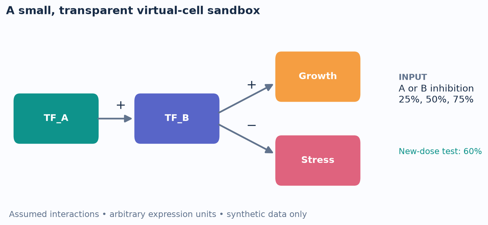
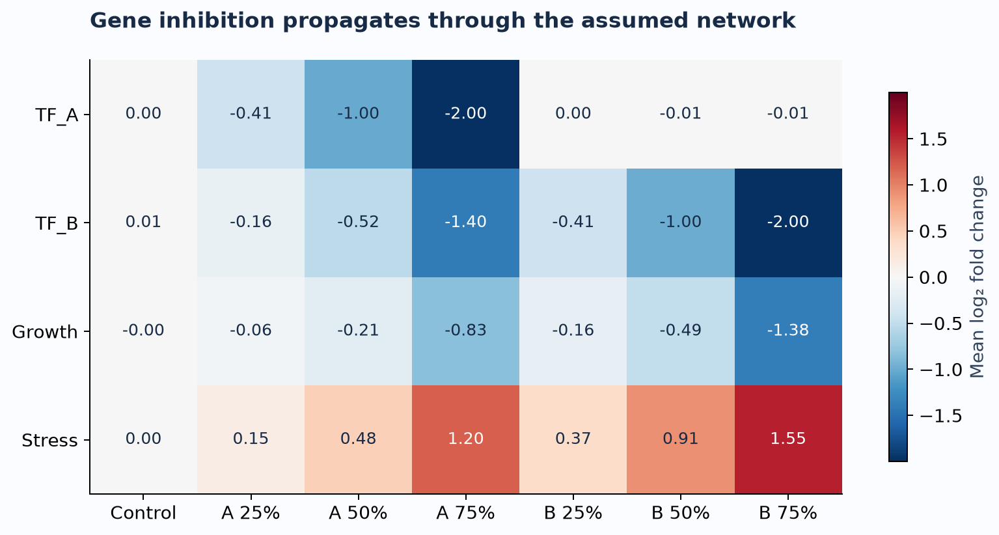
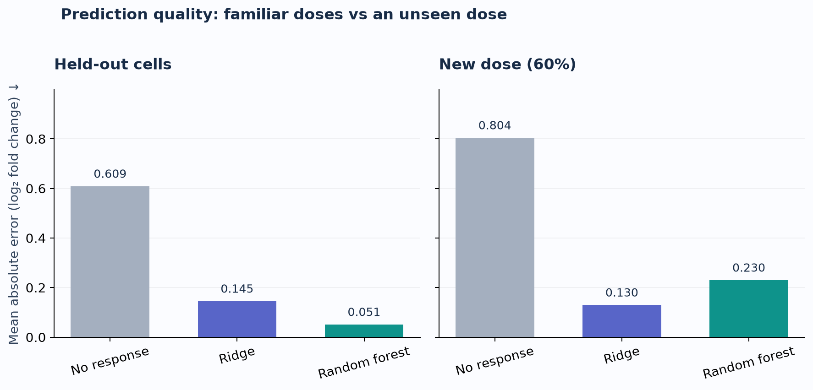
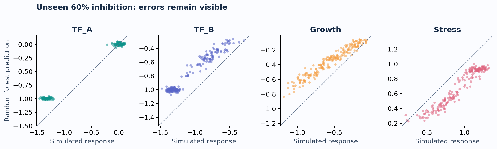
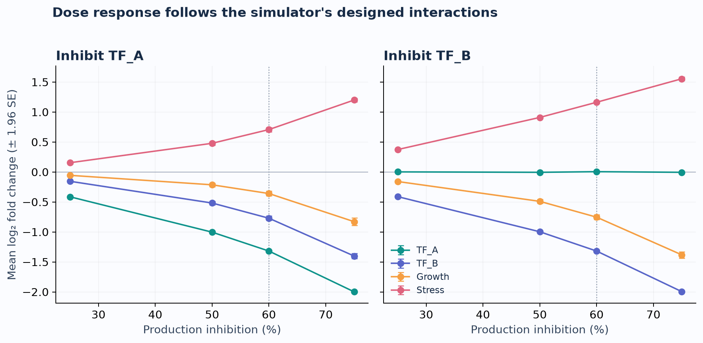
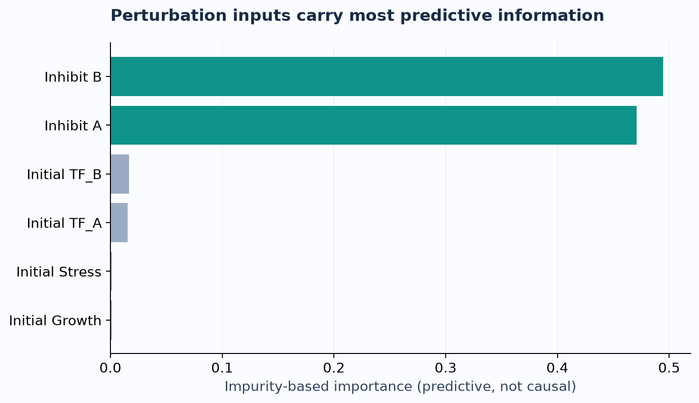

# Virtual Cell Sandbox

**Can a small machine-learning model predict how a simulated cell responds to gene inhibition—and does it generalize to an unseen dose?**

A compact data science project by **Shichuan Cheng**, MSc Data Science (Precision Medicine), University of Macau. Prepared for **CISC7204 Practice 09**. Status: **completed educational prototype; biological validation is future work**.

> **Synthetic-data study.** All four genes and regulatory connections are hypothetical. “Growth” and “Stress” are convenient gene labels, not measured cell phenotypes. The project does not represent a validated human cell, real drug response, or patient-level prediction.

[Live portfolio](https://HenryCHENG666.github.io/data-science-portfolio/) · [Analysis notebook](notebooks/virtual_cell_analysis.ipynb) · [Results](results/metrics.csv)



## Problem and scope

A virtual cell is a computational representation used to explore cellular behavior. This project studies one small component: predicting expression changes after an intervention. It deliberately uses a transparent four-gene simulator, rather than claiming to construct a full AI virtual cell.

Research questions:

1. How does inhibiting TF_A or TF_B affect downstream simulated expression?
2. Can Ridge regression and a random forest predict the four-gene response of held-out cells?
3. Does the model ranking change at a dose excluded from training?

## Dataset source and permissions

**Source:** `src/virtual_cell.py`, created for this project; seed `7204`. No external expression dataset is downloaded. The published CSV contains **400 synthetic cell identities × 9 conditions = 3,600 rows**. Conditions are control, A/B inhibition at 25%, 50%, 75%, and an additional 60% dose reserved for evaluation.

**Permissions:** project code, generated data, text and figures are released under the [MIT license](LICENSE). No human participants, personal records, restricted datasets, passwords or API keys are included. The background paper below motivates the topic; its figures and data are not reused.

| Columns | Meaning |
|---|---|
| `cell_id` | Synthetic identity; repeated across conditions to support paired comparisons |
| `condition`, `domain` | Intervention and standard/new-dose evaluation domain |
| `dose_A`, `dose_B` | Fractional reduction in production, from 0 to 0.75 |
| `baseline_*` | Noisy pre-intervention expression in arbitrary units |
| `post_*` | Independently measured expression after 12 arbitrary time units |
| `lfc_*` | Target: log2(post / baseline) |

## Methods and tools

### 1. Transparent simulation

For each cell and gene, production-rate multipliers are sampled from `LogNormal(0, 0.22)`. We integrate `dx/dt = production(x) − 0.8x` using forward Euler with step `0.02`. The activation function is `h(z) = z² / (0.8² + z²)`:

- `production_A = rate_A × 1.4 × (1 − dose_A)`
- `production_B = rate_B × (0.2 + 1.6h(A)) × (1 − dose_B)`
- `production_Growth = rate_Growth × (0.2 + 1.8h(B))`
- `production_Stress = rate_Stress × (0.2 + 1.5(1 − h(B)))`

Starting from expression 1, each cell runs for 40 units to establish a baseline, then for 12 units under intervention. Baseline and endpoint measurements receive independent multiplicative `LogNormal(0, 0.03)` noise. These choices are modeling assumptions, not estimated biological parameters. The simulator can be deterministic after parameters are sampled; observed measurements remain noisy.

### 2. Data preparation and evaluation design

Four baseline measurements and two intervention doses are the six model inputs. Post-intervention expression is used **only to define targets**, never as an input. `GroupShuffleSplit` splits identities into **300 training cells and 100 test cells**; all conditions of a cell stay in one group. Training uses 2,100 rows; the familiar-dose test uses 700 rows. The unseen-dose test contains 200 additional rows from the same 100 held-out cells at 60% inhibition. The two test sets share cell identities and are not independent replicates.

### 3. Models and metrics

- **No-response baseline:** predict zero log2 fold change for every gene.
- **Ridge:** standardize inputs on training data only, then fit `alpha=1`.
- **Random forest:** 200 trees, minimum leaf size 3, fixed seed, one CPU worker.

Settings were fixed in advance; there is no hyperparameter search. Models are fitted once on training cells. Report mean absolute error (MAE; lower is better) averaged equally across four genes and multi-output R² (uniform average). The new-dose test diagnoses interpolation to an unobserved input value, not extrapolation beyond the training range. Python, NumPy, pandas, Matplotlib and scikit-learn implement the workflow.

## Key findings

| Evaluation | No-response MAE | Ridge MAE | Random forest MAE |
|---|---:|---:|---:|
| Held-out cells, familiar doses | 0.6090 | 0.1453 | **0.0513** |
| Held-out cells, unseen 60% dose | 0.8044 | **0.1298** | 0.2302 |

1. **The assumed network produces coherent downstream effects.** At 75% B inhibition, mean Growth expression changes by −1.38 log2 units and Stress by +1.55, across the 100 test cells. These effects follow the equations by design; they do not discover real biology.
2. **Random forest predicts familiar doses well:** its MAE is about 65% lower than Ridge on held-out cells at trained doses.
3. **The ranking reverses at an unseen dose:** Ridge has about 44% lower MAE than random forest at 60%. Tree predictions are piecewise constant in their inputs, which is consistent with this interpolation difficulty. This is one seeded experiment, not a universal ranking of model classes.









Error bars show ±1.96 standard errors across 100 synthetic test cells. They describe simulator sampling variation, not experimental or clinical uncertainty. Lines connect simulated doses for readability; they do not represent measured intermediate doses.



Impurity-based importance is model-specific and can be biased; it is not evidence of causal importance.

## Limitation and next steps

**Main limitation: all results come from the same assumed simulator.** Generalizing to simulated cells or an unseen synthetic dose does not establish performance on real cells. Four genes omit most cellular biology, and the single random split omits uncertainty about model rankings. Next, use several grouped random seeds and then a suitably licensed public perturbation dataset with independent biological replicates. Add an explicit validation split before tuning models. Real-data work must account for cell type, experimental batch and replicate structure.

## Reproduce the analysis

Tested with Python **3.12.14** on Apple Silicon. No GPU or credentials required.

```bash
git clone https://github.com/HenryCHENG666/data-science-project.git
cd data-science-project
python3.12 -m venv .venv
source .venv/bin/activate
python -m pip install -r requirements.txt
python src/analyze.py
python -m unittest discover -s tests -v
```

On Windows, activate with `.venv\Scripts\activate`. Alternatively, use `uv venv --python 3.12` followed by `uv pip install -r requirements.txt`.

To explore the notebook, run `python -m pip install notebook`, then `python -m notebook notebooks/virtual_cell_analysis.ipynb`. The notebook uses the same modules and can regenerate the published analysis. Open it on GitHub to view committed outputs without installing Jupyter.

Expected output: six PNG and SVG figures, generated CSV data, metric and prediction tables, `split.json` with exact held-out identities, and `summary.json`. Small numerical differences across library/platform versions are possible. Running the script overwrites generated outputs, not source files.

## Repository map and data flow

```text
src/virtual_cell.py  →  data/synthetic_cells.csv
         ↓
src/analyze.py       →  grouped split → fitted models
         ↓
results/            →  metrics, predictions, split, summary
figures/            →  six readable plots (PNG + SVG)
notebooks/          →  guided analysis with saved outputs
tests/              →  reproducibility, split isolation, step-size checks
```

`src/virtual_cell.py` owns the simulation; `src/analyze.py` owns fitting, evaluation and plotting. This keeps biological assumptions separate from predictive analysis.

## References

- Bunne et al. (2024). *How to build the virtual cell with artificial intelligence: Priorities and opportunities*. Cell. [doi:10.1016/j.cell.2024.11.015](https://doi.org/10.1016/j.cell.2024.11.015). Background motivation only.
- scikit-learn. [GroupShuffleSplit](https://scikit-learn.org/stable/modules/generated/sklearn.model_selection.GroupShuffleSplit.html), [Ridge](https://scikit-learn.org/stable/modules/generated/sklearn.linear_model.Ridge.html), [RandomForestRegressor](https://scikit-learn.org/stable/modules/generated/sklearn.ensemble.RandomForestRegressor.html).

## AI assistance and review status

AI assistance was used through OpenAI Codex for project design, implementation, documentation, visualizations and debugging. Analysis results were generated by executing the code; no experimental findings or classmate comments were fabricated. This prototype was checked computationally; the course-required classmate review and feedback-based improvement remain pending until actual feedback is received. The student should review and understand the project before presenting it as coursework.
